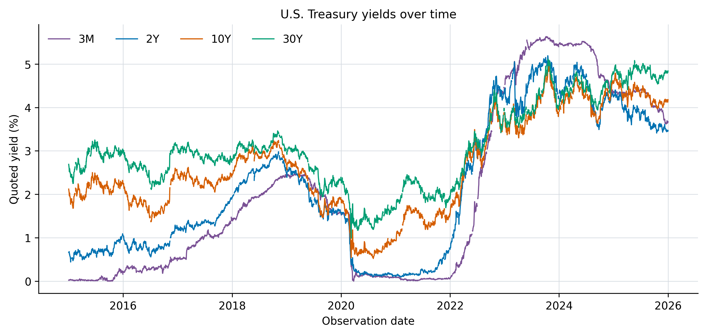
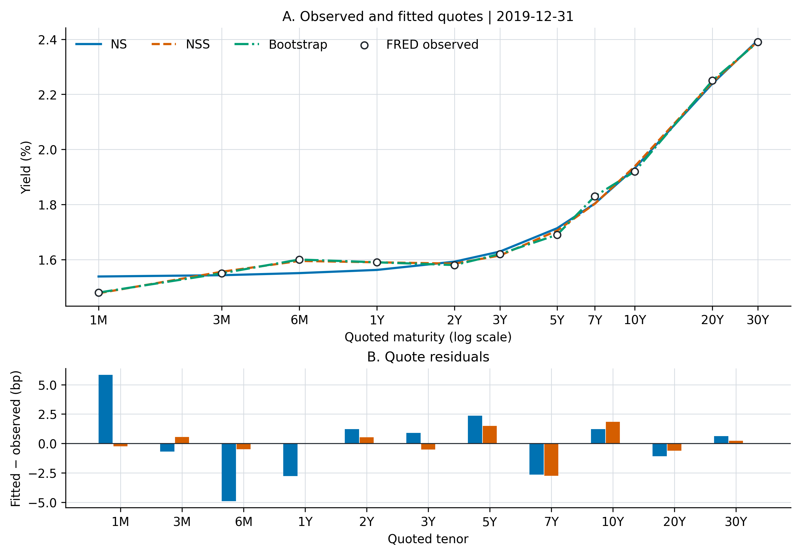
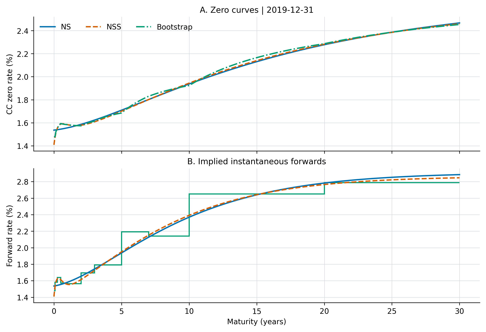
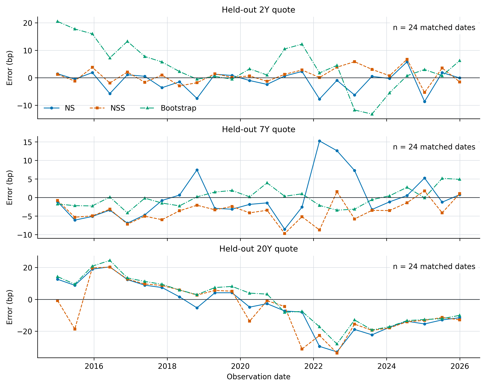
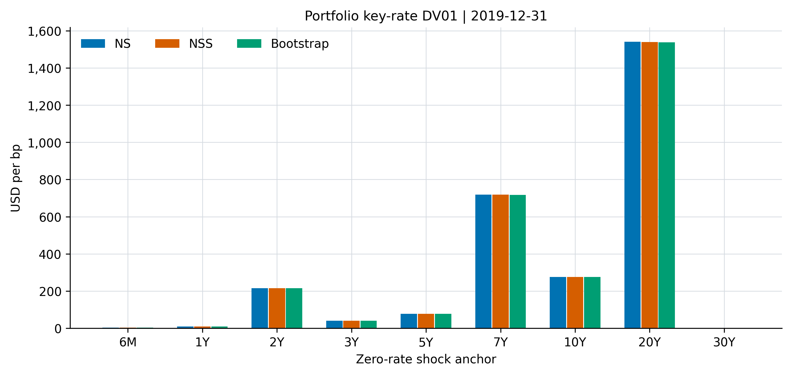
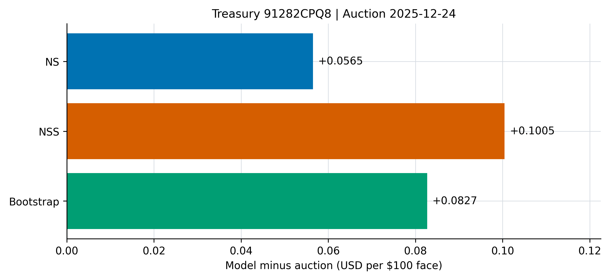
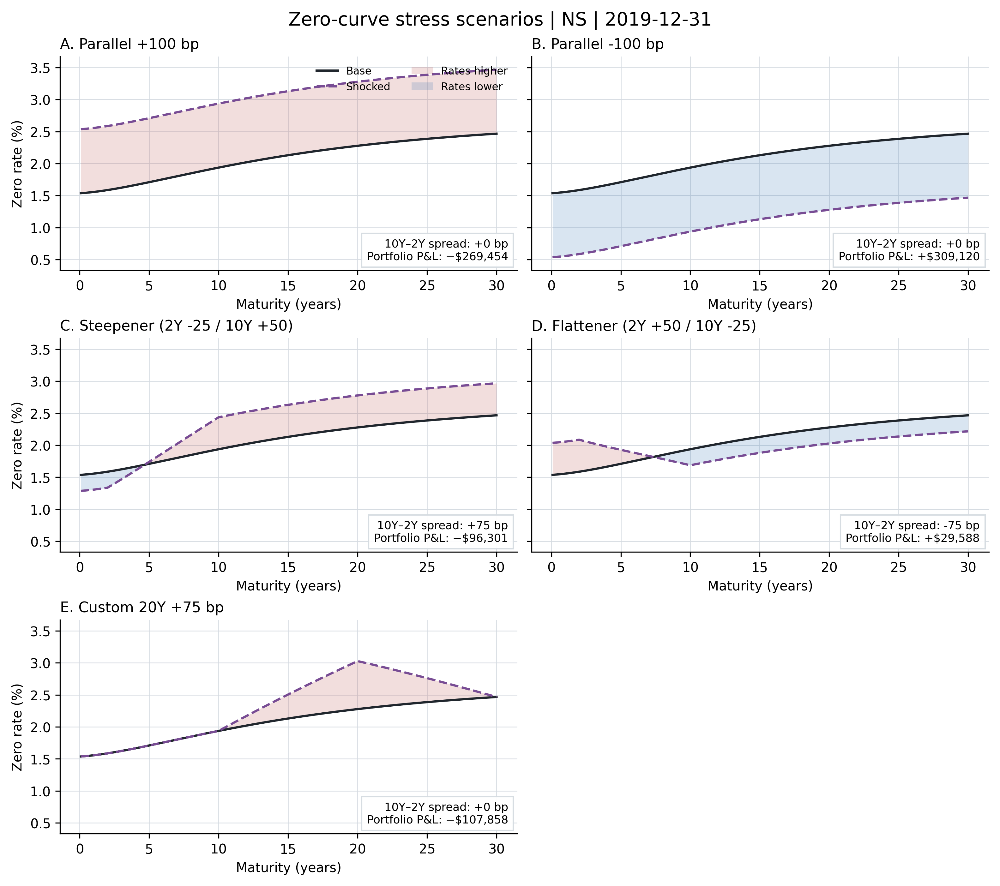
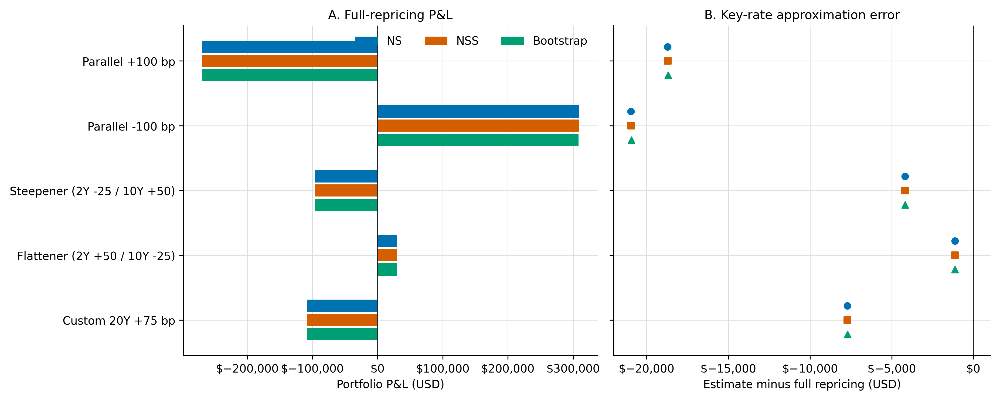

# U.S. Treasury Curve Construction, Key-Rate Risk, and Stress Testing

A reproducible study that builds U.S. Treasury discount curves from FRED constant-maturity yields, validates them out of sample, and uses them to measure and stress-test the interest-rate risk of a synthetic fixed-rate bond portfolio.

> **Scope.** The portfolio is synthetic and the stress scenarios are illustrative, not regulatory specifications. This is a numerical-methods study, not a trading-performance or forecasting study. Results are tied to one valuation date, listed in the configuration table below.

## What this project does

1. Downloads eleven Treasury constant-maturity series (1M to 30Y) from FRED and stores the raw bytes with SHA-256 hashes.
2. Fits three discount curves to the same quotes: Nelson-Siegel (NS), Nelson-Siegel-Svensson (NSS), and a par-yield bootstrap.
3. Validates the curves by holding out interior quotes (2Y, 7Y, 20Y) and predicting them from the rest.
4. Prices a three-bond portfolio and computes duration, convexity, and key-rate DV01 (KR01).
5. Compares each model with one published Treasury auction price.
6. Stress-tests the portfolio by full repricing and reports how far first-order approximations are from it.

## Start here

- [Research notebook](notebooks/YIELD_CURVE_MODELLING_clean.ipynb)
- [Key results](#key-results)
- [Result tables](results/tables/) and [figures](results/figures/)
- [Figure captions](results/figures/figure_index.csv)
- [Raw and working data](data/) with its [manifest](data/manifest.json)
- [Run metadata](results/export_metadata.json), [file inventory](results/inventory.csv) and [SHA-256 checksums](results/SHA256SUMS.txt)

## Methods

### Notation

`D(t)` is the discount factor to time `t` in years, `z(t)` the continuously compounded zero rate, `y(T)` a quoted yield, `CF_i` a bond cash flow, and `P` a present value. Zero rates and discount factors are linked by:

```math
D(t) = e^{-t\,z(t)}
```

### Quotes and curve conventions

FRED yields are converted from percent to decimals; nothing is imputed or forward-filled, and only dates with all eleven tenors are used. The quotes are par-style yields, not zero rates, so every model is fitted through a quote mapping. For maturities below one year the model quote is a simple-interest yield:

```math
y(T) = \frac{1/D(T) - 1}{T}
```

For maturities of one year or more it is a semiannual par yield, with coupon dates `t_i = i/2`:

```math
y(T) = \frac{2\left(1 - D(T)\right)}{\sum_{i=1}^{2T} D(t_i)}
```

### Parametric curves

Nelson-Siegel uses level, slope, and curvature loadings, with `x = t / tau_1`:

```math
z_{\mathrm{NS}}(t) = \beta_0 + \beta_1\,\frac{1 - e^{-x}}{x} + \beta_2\left(\frac{1 - e^{-x}}{x} - e^{-x}\right)
```

Svensson adds a second curvature term with its own decay `tau_2`, where `x_2 = t / tau_2`:

```math
z_{\mathrm{NSS}}(t) = z_{\mathrm{NS}}(t) + \beta_3\left(\frac{1 - e^{-x_2}}{x_2} - e^{-x_2}\right)
```

Parameters minimise squared quote errors in basis points, with bounds and several starting values for the decay parameters. The best converged fit is kept, and parameters sitting on a bound are reported.

### Bootstrap

Node discount factors are solved sequentially so each par quote is repriced exactly, with log-linear interpolation of `D`. For a node at maturity `T` of one year or more, the root solves:

```math
D(T) + \frac{y}{2}\sum_{i=1}^{2T} D(t_i) = 1
```

The implied forward curve is piecewise constant by construction. The notebook stops if the bootstrap fails to reprice its own quotes to numerical tolerance.

### Out-of-sample validation

On evenly spaced dates one interior quote is removed, each model is refitted on the other ten, and the removed quote is predicted. Only trials in which all three models succeed enter the comparison, so models are scored on identical cases. Dates are sampled, and adjacent dates are correlated, so the trial count overstates independent evidence.

### Bond pricing and risk

A bond with face `F`, annual coupon `c`, and maturity `T` pays `cF/2` every half year plus `F` at maturity. Its present value is:

```math
P = \sum_{i=1}^{2T} \mathrm{CF}_i\,D(t_i)
```

Shocks apply to zero rates at nine key-rate anchors (6M, 1Y, 2Y, 3Y, 5Y, 7Y, 10Y, 20Y, 30Y), interpolated linearly and held flat outside them. With shock `s(t)` in basis points:

```math
D_s(t) = D(t)\,\exp\!\left(-t\,s(t)\cdot 10^{-4}\right)
```

Parallel dollar duration and convexity use central differences with bump size `h`, and are cross-checked against discounted cash-flow moments:

```math
\mathcal{D} = \frac{P_{-} - P_{+}}{2h} = \sum_i t_i\,\mathrm{CF}_i\,D(t_i)
```

```math
\mathcal{C} = \frac{P_{+} + P_{-} - 2P_0}{h^2} = \sum_i t_i^2\,\mathrm{CF}_i\,D(t_i)
```

DV01 is `10^-4` times the dollar duration. Key-rate DV01 bumps one anchor at a time and is reconciled to parallel DV01. A positive value means a loss when rates rise.

### Stress testing

For a scenario with anchor shocks `s_k` in basis points, the engine reports full-repricing P&L, the shocked present value minus `P_0`, as the reference. Two approximations are compared with it. The key-rate estimate is:

```math
\widehat{\Delta P}_{\mathrm{KR}} = -\sum_k \mathrm{KR01}_k\,s_k
```

The duration-plus-convexity estimate applies to parallel shifts `Δy` only:

```math
\widehat{\Delta P}_{\mathrm{D+C}} = -\mathcal{D}\,\Delta y + \tfrac{1}{2}\,\mathcal{C}\,\Delta y^2
```

Approximation error is defined as estimate minus full repricing, in dollars. Steepeners and flatteners are specified by their 2Y and 10Y shocks, interpolated between those anchors.

### Treasury auction check

One regular 7-year note auction is used as a sanity check, not a validation sample. The model price at issue settlement is:

```math
P_{\mathrm{model}} = \sum_i \mathrm{CF}_i\,\frac{D(t_i)}{D(t_{\mathrm{issue}})}
```

Times are actual days divided by 365 from the auction date, using scheduled coupon dates without business-day adjustment. Curve and auction are matched by calendar date, not timestamp, so a small gap is not by itself evidence of model error.

## Configuration

| Setting | Value |
|---|---|
| FRED window | 2015-01-01 to 2025-12-31 |
| Complete 11-tenor curve dates | 2,750 |
| Valuation date | 2019-12-31 |
| Held-out tenors | 2Y, 7Y, 20Y |
| Validation dates | 24 evenly spaced complete-curve dates |
| Matched held-out trials | 72 (24 dates x 3 tenors) |
| Portfolio | 2Y at 3.5%, 7Y at 4.0%, 20Y at 4.5%; USD 1,000,000 face each |
| Default scenarios | Parallel +100 bp, Parallel -100 bp, Steepener (2Y -25 / 10Y +50), Flattener (2Y +50 / 10Y -25), Custom 20Y +75 bp |
| Auction check | 7-year note, CUSIP 91282CPQ8, auction 2025-12-24, issue 2025-12-31 |

The notebook is deterministic: there is no random simulation.

## Key results

The values below come from the saved CSVs in `results/tables/`. They describe this run only; the tables remain the source of truth.

### Curve fit on the valuation date

| Model | In-sample RMSE (bp) | Max abs error (bp) | Converged starts | Parameters on a bound |
|---|---:|---:|---|---|
| NS | 2.77 | 5.84 | 3/3 | None |
| NSS | 1.16 | 2.74 | 6/6 | None |
| Bootstrap | about 0 | about 0 | not applicable | not applicable |

The bootstrap reprices its own inputs by construction, so its in-sample error is not evidence of quality. The 1Y1Y implied forward is 1.62% (NS), 1.57% (NSS) and 1.56% (bootstrap). Implied forwards are model outputs, not forecasts.

[One-date fit summary](results/tables/one_date_fit_summary.csv) · [Forward summary](results/tables/forward_summary.csv)

### Held-out validation

72 matched trials, scored on identical cases for all three models:

| Model | Bias (bp) | MAE (bp) | RMSE (bp) | 95th pct abs error (bp) |
|---|---:|---:|---:|---:|
| NS | -1.90 | 6.55 | 9.50 | 19.62 |
| NSS | -2.90 | 6.60 | 9.69 | 19.99 |
| Bootstrap | +1.09 | 7.03 | 9.65 | 19.83 |

Held-out RMSE by tenor (bp):

| Held-out tenor | NS | NSS | Bootstrap |
|---|---:|---:|---:|
| 2Y | 3.76 | 2.90 | 9.15 |
| 7Y | 5.75 | 4.66 | 2.46 |
| 20Y | 14.96 | 15.86 | 13.76 |

The three models are close overall. NSS fits the quotes best in-sample, but that advantage does not appear out of sample. The bootstrap is weakest at 2Y and strongest at 7Y, and all three models are least accurate at the long end. The 72 trials come from correlated dates, so the sub-bp gaps between models should not be read as a ranking.

[Overall](results/tables/held_out_overall.csv) · [By tenor](results/tables/held_out_by_tenor.csv) · [All trials](results/tables/held_out_trials.csv)

### Portfolio value and key-rate risk (2019-12-31)

| Model | Portfolio PV (USD) | Duration (years) | Parallel DV01 (USD/bp) |
|---|---:|---:|---:|
| NS | 3,551,182 | 8.11 | 2,881.62 |
| NSS | 3,550,467 | 8.11 | 2,879.96 |
| Bootstrap | 3,547,249 | 8.11 | 2,876.29 |

The portfolio value differs by about 3,900 USD (0.11%) across models. Key-rate DV01 reconciles to parallel DV01 to within 0.001 USD/bp for every bond and model. By bond (NS curve), parallel DV01 is 202 USD/bp for the 2Y, 714 for the 7Y and 1,966 for the 20Y, so the 20Y bond carries about two thirds of the portfolio risk.

[Parallel risk](results/tables/bond_parallel_risk.csv) · [Key-rate risk](results/tables/bond_key_rate_risk.csv) · [Base valuations](results/tables/base_bond_valuations.csv)

### Stress testing (NS curve)

Estimate minus full repricing, in USD:

| Scenario | Full-repricing P&L | Key-rate error | Duration + convexity error |
|---|---:|---:|---:|
| Parallel +100 bp | -269,454 (-7.59%) | -18,708 | +1,073 |
| Parallel -100 bp | +309,120 (+8.70%) | -20,958 | -1,177 |
| Steepener (2Y -25 / 10Y +50) | -96,301 (-2.71%) | -4,191 | not applicable |
| Flattener (2Y +50 / 10Y -25) | +29,588 (+0.83%) | -1,136 | not applicable |
| Custom 20Y +75 bp | -107,858 (-3.04%) | -7,717 | not applicable |

The key-rate estimate is first-order, so it overstates losses and understates gains: its error is about 7% of full-repricing P&L for the parallel and 20Y shocks, and 4% for the two twists. Adding convexity reduces the parallel error to about 0.4%. The other two curves give almost the same numbers; the full set is in the CSVs.

[Stress summary](results/tables/portfolio_stress_summary.csv) · [By bond](results/tables/stress_by_bond_and_portfolio.csv) · [Scenario shocks](results/tables/scenario_shocks_bp.csv)

### Treasury auction check

| Model | Model price per 100 | Auction price per 100 | Model minus auction |
|---|---:|---:|---:|
| NS | 99.7227 | 99.6663 | +0.0565 |
| NSS | 99.7667 | 99.6663 | +0.1005 |
| Bootstrap | 99.7490 | 99.6663 | +0.0827 |

All three models price the note 5 to 10 cents per 100 above its published auction price. This is one auction on one date, so it is a sanity check and not a validation sample. The curve is matched by calendar date, not timestamp.

[Price comparison](results/tables/price_comparison.csv) · [Cash flows](results/tables/cashflows.csv)

## Figures

















Figure 07 shades where the shocked curve lies above (red) or below (blue) the base curve. The shading is the scenario difference, not a confidence band. Each figure is saved as PNG and as vector PDF in the same folder.

## Results tables

All numbers are in `results/tables/`.

| Topic | Files |
|---|---|
| Curve fit and forwards | `one_date_quotes.csv`, `one_date_fit_summary.csv`, `forward_summary.csv`, `spot_discount_forward_grid.csv` |
| Held-out validation | `held_out_trials.csv`, `held_out_overall.csv`, `held_out_by_tenor.csv` |
| Bond valuation and risk | `base_bond_valuations.csv`, `par_pricing_checks.csv`, `bond_parallel_risk.csv`, `bond_key_rate_risk.csv` |
| Auction check | `price_comparison.csv`, `cashflows.csv` |
| Stress testing | `scenario_shocks_bp.csv`, `stress_by_bond_and_portfolio.csv`, `portfolio_stress_summary.csv` |

## Limitations

- FRED constant-maturity yields are par-style quotes. The zero curves are model constructions that depend on the quote-to-curve mapping above.
- A bootstrap reprices its inputs exactly by construction; in-sample fit says nothing about out-of-sample behaviour, which is why quotes are held out.
- Validation uses sampled dates and three interior tenors, with correlated trials.
- The auction comparison is a single observation on one calendar date.
- The key-rate estimate is first-order. Large or sharply non-parallel shocks leave visible error against full repricing, and that error is reported rather than assumed small.
- Sections 3 and 4 use a single valuation date.

## Repository layout

```text
.
├── README.md
├── requirements.txt
├── notebooks/
│   └── YIELD_CURVE_MODELLING_clean.ipynb
├── data/
│   ├── manifest.json
│   ├── tenor_coverage.csv
│   ├── yields_percent.csv
│   ├── yields_decimal.csv
│   ├── raw/                  (eleven FRED series)
│   └── treasury_auction/     (raw API response and metadata)
├── results/
│   ├── tables/               (computed CSVs)
│   ├── figures/              (PNG, PDF and figure_index.csv)
│   ├── export_metadata.json
│   ├── inventory.csv
│   └── SHA256SUMS.txt
└── report/                   (reserved for the written report)
```

## Reproducing

1. Open `notebooks/YIELD_CURVE_MODELLING_clean.ipynb` in Google Colab or Jupyter (Python 3.10+; `numpy`, `pandas`, `scipy`, `matplotlib`, `requests`, `ipywidgets`).
2. Adjust the configuration cell if needed and run all cells in order. Internet access is required for FRED and the Treasury Fiscal Data API.
3. Section 5 builds the figure and export bundle. The interactive stress playground in Section 4 needs a live session and does not render on GitHub.

The saved run used Python 3.13.18, NumPy 2.4.6, pandas 2.2.3, SciPy 1.16.3, Matplotlib 3.10.0 and requests 2.32.4 (see `results/export_metadata.json`). These are recorded versions, not a tested compatibility range.

Data retrieved at run time is stored with a manifest of URLs, timestamps, and SHA-256 hashes. The inventory and checksum files in `results/` support integrity checks after transfer. A matching hash shows file integrity, not financial correctness.

## References

- Nelson, C. R. and Siegel, A. F. (1987). Parsimonious modeling of yield curves. *Journal of Business*, 60(4), 473-489.
- Svensson, L. E. O. (1994). Estimating and interpreting forward interest rates: Sweden 1992-1994. NBER Working Paper 4871.
- Ho, T. S. Y. (1992). Key rate durations: Measures of interest rate risks. *Journal of Fixed Income*, 2(2), 29-44.
- Federal Reserve Board, H.15 Selected Interest Rates, via FRED.
- U.S. Department of the Treasury, Fiscal Data: Treasury Securities Auctions Data.

## Author

Abilfazal Unwala
